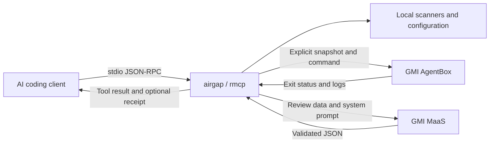

# Architecture

airgap is one Cargo package with a binary entry point and library modules shared by the tests. The runtime is Rust; packaging and measurement scripts are separate maintainer tools.

## Request flow

`main.rs` loads configuration, creates the shared HTTP client and serves MCP over stdio. The tool router defines the seven public tools and their generated input schemas. No provider call occurs during startup.

Local scanners return results directly. Cloud tools validate the input, take a bounded concurrency slot and call the appropriate provider. AgentBox jobs upload an in-memory archive, execute inside `/workspace`, collect output and delete their sandbox before deleting the template. A tracked task keeps cleanup alive when the MCP caller cancels.

Runtime model and timeout settings are snapshotted for each request. Updating defaults does not change credentials or provider destinations and does not rewrite a running job's settings.

## Source map

| Path | Responsibility |
| --- | --- |
| `src/main.rs` | Stdio server lifecycle and shutdown signals |
| `src/config.rs` | Trusted environment discovery, precedence and validation |
| `src/gmi/agentbox.rs` | Archive creation, remote lifecycle, execution and teardown |
| `src/gmi/maas.rs` | Inference requests and strict JSON decoding |
| `src/gmi/mod.rs` | Shared HTTP client and bounded response reading |
| `src/tools/` | Tool input types, routing and behavior |
| `src/receipt.rs` | Integrity hashes and receipt verification |
| `tests/` | Protocol, provider-mock and scanner regression tests |

## Trust boundaries

Commands are never passed to a local shell. Only explicitly submitted UTF-8 files are packed; repository discovery and binary/symlink uploads are not implemented. Cloud output and model prose remain untrusted data after parsing or redaction.

The repository audit executes a fixed inventory command. Model-generated text is never executed. Matching an audit quote to a source line establishes provenance, not exploitability. See [the security model](security-model.md) and [tool reference](reference.md).
